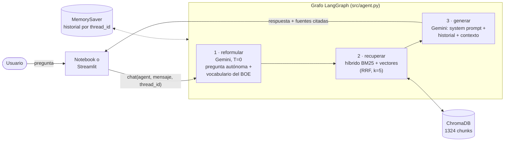
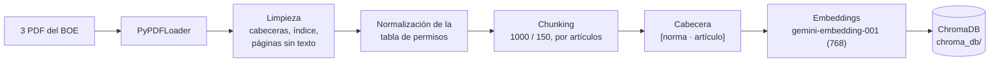

# 🏍️ Asistente de Tráfico y Permisos de Moto (RAG)

Asistente conversacional que responde dudas sobre la **normativa de tráfico española** y, en concreto, sobre los **permisos de moto** (AM, A1, A2, A y B), a partir de los textos consolidados del BOE. Usa **RAG** (*Retrieval-Augmented Generation*): busca los artículos relevantes, responde solo con ellos y cita la norma y el artículo.

**App en Streamlit Cloud:** https://proyectoiagenerativa-zdv9qh6hfpquydc2nf7pmu.streamlit.app/

**Stack:** Google Gemini (LLM y embeddings) · ChromaDB · BM25 · LangGraph + LangChain · Jupyter · Streamlit.

---

## Índice

1. [Dominio elegido](#1-dominio-elegido)
2. [Arquitectura](#2-arquitectura)
3. [Fuentes de datos](#3-fuentes-de-datos)
4. [Decisiones técnicas](#4-decisiones-técnicas)
5. [System prompt](#5-system-prompt)
6. [Requisitos](#6-requisitos)
7. [Instalación y ejecución](#7-instalación-y-ejecución)
8. [Estructura del repositorio](#8-estructura-del-repositorio)
9. [Limitaciones y posibles mejoras](#9-limitaciones-y-posibles-mejoras)

---

## 1. Dominio elegido

**Normativa de tráfico española, centrada en motos y permisos de conducción.**

Por qué:
- **Es un problema real y frecuente.** Quien quiere sacarse el carnet de moto se hace siempre las mismas preguntas: ¿qué edad necesito para el A2?, ¿puedo llevar una moto con el carnet de coche?, ¿cómo paso del A2 al A? Las respuestas están en el BOE, pero repartidas entre varias normas largas y escritas en lenguaje jurídico.
- **Es un caso donde el RAG aporta mucho.** Un LLM «sabe» cosas de tráfico, pero pueden estar desactualizadas o mezcladas con las de otros países. Con RAG cada respuesta sale del texto vigente y se puede comprobar con el artículo citado.
- **Las fuentes son oficiales, públicas y estables:** textos consolidados del BOE, que incluyen todas las modificaciones.
- **Tiene retos técnicos interesantes:** tablas que el PDF extrae mal, códigos cortos («A2», «B») que los embeddings distinguen mal, y lenguaje coloquial («carnet de coche») frente al jurídico («permiso de la clase B»).

## 2. Arquitectura

### Flujo de una pregunta (agente LangGraph)



1. **`reformular`**: reescribe la última pregunta para que se entienda sola, usando los últimos 3 turnos («¿Y cuánto tiempo tengo que tener el anterior?» → «¿Cuánto tiempo es necesario tener el permiso de la clase A2 para obtener el permiso de la clase A?»). También la pasa al vocabulario del BOE.
2. **`recuperar`**: busca los 5 fragmentos más relevantes con la pregunta reformulada.
3. **`generar`**: Gemini responde usando solo esos fragmentos y cita norma y artículo. Después, `chat()` detecta qué artículos cita la respuesta y los devuelve como fuentes.

### Construcción de la base de conocimiento (una sola vez)



## 3. Fuentes de datos

Textos **consolidados** del BOE, es decir, la versión vigente con todas las modificaciones incorporadas:

| Norma | Referencia | Contenido relevante | PDF |
|---|---|---|---|
| Reglamento General de Conductores | RD 818/2009 · BOE-A-2009-9481 | Clases de permiso, edades mínimas, acceso progresivo, exámenes | [PDF](https://www.boe.es/buscar/pdf/2009/BOE-A-2009-9481-consolidado.pdf) · [web](https://www.boe.es/buscar/act.php?id=BOE-A-2009-9481) |
| Reglamento General de Circulación | RD 1428/2003 · BOE-A-2003-23514 | Velocidades, casco, pasajeros, adelantamientos… | [PDF](https://www.boe.es/buscar/pdf/2003/BOE-A-2003-23514-consolidado.pdf) · [web](https://www.boe.es/buscar/act.php?id=BOE-A-2003-23514) |
| Ley de Tráfico y Seguridad Vial | RDL 6/2015 · BOE-A-2015-11722 | Infracciones, sanciones y permiso por puntos | [PDF](https://www.boe.es/buscar/pdf/2015/BOE-A-2015-11722-consolidado.pdf) · [web](https://www.boe.es/buscar/act.php?id=BOE-A-2015-11722) |

| Norma | Páginas PDF | Páginas con texto útil | Chunks |
|---|---|---|---|
| Reglamento General de Conductores | 109 | 97 | 470 |
| Reglamento General de Circulación | 730 | 109 | 509 |
| Ley de Tráfico y Seguridad Vial | 74 | 66 | 345 |
| **Total** | **913** | **272** | **1324** |

El PDF del Reglamento General de Circulación ocupa 258 MB (supera el límite de GitHub), así que no está en el repositorio. Solo hace falta para volver a indexar; ver [Instalación](#7-instalación-y-ejecución).

## 4. Decisiones técnicas

El notebook `notebooks/proyecto_final.ipynb` explica cada decisión con ejemplos y resultados. Este es el resumen.

### Limpieza del texto
- Se quitan las **cabeceras y pies** del BOE (`BOLETÍN OFICIAL DEL ESTADO`, `Página N`). Aparecen en casi todas las páginas, y si se dejaran, todos los embeddings se parecerían entre sí.
- Se descartan las **páginas de índice** (se detectan por las líneas con puntos guía) y las **páginas sin texto**. Unas 600 páginas del Reglamento de Circulación son imágenes del catálogo de señales.
- Se unen las palabras cortadas con guion y las líneas partidas a mitad de frase.
- **Tabla de clases de permiso (art. 4).** `pypdf` la extrae como líneas sueltas («A2» / descripción / «18»), y en la primera versión la edad del A2 no se recuperaba. Ahora cada fila se reescribe como texto autocontenido: «Permiso de la clase A2. Vehículos que autoriza a conducir: … Edad mínima para el permiso de la clase A2: 18 años cumplidos.» Solo se etiquetan las columnas; no se inventa texto.

### Chunking
- `RecursiveCharacterTextSplitter` con **`chunk_size=1000`** caracteres (~250 tokens) y **`chunk_overlap=150`** (~15 %). Así un apartado de un artículo cabe entero, y el embedding representa una sola idea. Con k=5, el contexto que recibe el LLM ronda los 5.000 caracteres.
- **Separadores con prioridad jurídica**: inicio de `Artículo N.`, luego disposiciones, anexos, títulos o capítulos, filas de la tabla de permisos, párrafos, frases y palabras. El encabezado del artículo queda siempre al principio del chunk.
- **Metadatos** por chunk: norma, referencia, página inicial y final, artículo(s) y título del artículo. Se usan para citar.
- **Cabecera de contexto**: cada chunk empieza con `[norma · título del artículo]`. Un trozo que continúa un artículo largo no contiene el título, y su embedding pierde el tema; la cabecera se lo devuelve.

### Embeddings y ChromaDB
- **`models/gemini-embedding-001`**, el modelo estable de texto de Gemini. Usa `task_type` (`RETRIEVAL_DOCUMENT` al indexar y `RETRIEVAL_QUERY` al buscar).
- **768 dimensiones** en vez de 3072. El modelo usa *Matryoshka*, así que se pierde muy poca calidad, y `chroma_db/` ocupa 4 veces menos. Importa porque se sube al repositorio para Streamlit Cloud.
- **ChromaDB persistente** con distancia coseno. La indexación funciona por **lotes con pausas y reintentos**, pensada para la capa gratuita. Es **idempotente y reanudable**: el ID de cada chunk incluye un hash de su contenido, así que solo se indexa lo que falta o lo que ha cambiado.

### Retriever: híbrido y k=5
- **Búsqueda híbrida**: vectores (ChromaDB) + **BM25** (palabras clave), fusionados con **Reciprocal Rank Fusion** (top-20 de cada lista y pesos iguales). Los embeddings captan el significado («casco obligatorio» ~ «elementos de protección»), pero distinguen mal códigos cortos como «A2», «B» o «125 cm³», que es justo donde BM25 acierta. El índice BM25 se construye con los chunks de Chroma, así que no necesita los PDF.
- **k = 5**: suficiente para que entren el artículo principal y los relacionados (p. ej. art. 4 y art. 5 para los permisos), sin llenar el contexto de ruido.
- Si la API de embeddings falla de forma puntual, el retriever sigue funcionando solo con BM25.
- En las 5 consultas de prueba del notebook, la respuesta esperada está en el top-5. La mejora decisiva fue la limpieza de la tabla y la cabecera de contexto: el chunk de la edad del A2 pasó de no aparecer a salir el 1.º.

### Reformulación de la pregunta
- Un LLM con **temperatura 0** reescribe la pregunta como **autónoma**, usando el historial. También la traduce al **vocabulario del BOE**: «carnet de coche» → «permiso de la clase B», «pasar al A» → «obtener el permiso de la clase A».
- Se hace **también en la primera pregunta**. En las pruebas, «Después de tener el A2, ¿cómo paso al A?» sin reformular no recuperaba el art. 5 y la respuesta era «no lo encuentro»; con la versión formal, el art. 5 sale arriba.
- Se ve en el notebook (línea «PREGUNTA INTERPRETADA»), lo que facilita depurar el retrieval.

### Memoria
- **`MemorySaver`** de LangGraph guarda el estado de cada conversación por **`thread_id`**: un hilo por ejecución del notebook y uno por sesión en Streamlit.
- El historial guarda **solo preguntas y respuestas**. El contexto del BOE se inyecta únicamente en el turno actual, así la memoria no crece con fragmentos de turnos anteriores.
- `reformular` ve los últimos 3 turnos y `generar` los últimos 5.
- Si un turno falla a mitad (p. ej. Gemini saturado), se elimina de la memoria la pregunta sin respuesta.

### LLM y robustez
- **`gemini-3.8-flash`**, con `gemini-flash-latest` y `gemini-3.5-flash` como **modelos de respaldo**. Para generar se deja la temperatura por defecto, porque Google recomienda no bajarla en los modelos Gemini 3.
- La capa gratuita devuelve a menudo `503 UNAVAILABLE`. `ResilientLLM` pone un **timeout de 45 s por intento**, **2 intentos por modelo** y un **límite de 300 s por llamada**. Además **muestra cada reintento** (en el notebook por pantalla y en Streamlit en el indicador de estado), para que se vea que no está colgado.

### Citas
- Cada fragmento del contexto lleva una línea `CITA: (Reglamento General de Conductores, art. 4)` generada a partir de los metadatos, y el modelo la copia. **No se le pasa el número de página**: en una versión anterior, a veces citaba «(pág. 12)» en vez del artículo.
- Como red de seguridad, `fix_citations` convierte cualquier «(pág. N)» o «[N]» que quede en la cita del chunk correspondiente.
- Las **fuentes** que se muestran son los artículos recuperados que la respuesta **cita de verdad**. En Streamlit aparecen en el desplegable «Fuentes», con norma, artículo y página.

## 5. System prompt

Está en [`src/prompts.py`](src/prompts.py). Texto completo:

```text
Eres «Asistente DGT Moto», un asistente experto en la normativa de tráfico española, especializado en motocicletas y en los permisos de conducción (AM, A1, A2, A y B).

## Cómo respondes
- Responde siempre en español, con un tono claro y cercano, como un buen profesor de autoescuela. Explica la norma con palabras sencillas y evita la jerga legal innecesaria; si tienes que usar un término técnico (p. ej. «relación potencia/peso»), explícalo brevemente.
- Ve al grano: empieza con la respuesta directa (p. ej. «18 años») y después da los detalles, excepciones y requisitos relevantes. Usa listas cuando ayuden a leer.

## Fuentes: solo el contexto
- Responde ÚNICAMENTE con la información del CONTEXTO que acompaña a cada pregunta (fragmentos del BOE: Reglamento General de Conductores, Reglamento General de Circulación y Ley de Tráfico y Seguridad Vial). No uses conocimientos propios para añadir datos, cifras ni requisitos.
- Cita la norma y el artículo de donde sale cada dato, por ejemplo: «(Reglamento General de Conductores, art. 4)». Cada fragmento del contexto lleva una línea «CITA: (…)» con la cita exacta: cópiala tal cual. Nunca cites números de página ni el número del fragmento ([1], [2]…): el usuario no los ve.
- Si el contexto no contiene la respuesta, o solo una parte, dilo con claridad («No encuentro esto en la normativa que tengo disponible») y no inventes ni completes con suposiciones. Puedes sugerir consultar la web de la DGT.
- El historial de la conversación sirve para entender a qué se refiere el usuario, pero los datos de la respuesta deben salir del contexto actual.

## Aviso
- Al final de cada respuesta sobre normativa añade una línea breve recordando que la normativa puede cambiar y que esta información no sustituye a la DGT ni al asesoramiento de un profesional (autoescuela, abogado). Una sola frase, sin repetirla a mitad de la respuesta.

## Fuera de tema
- Si la pregunta no tiene nada que ver con el tráfico, la conducción o los permisos, no la respondas: di con amabilidad que solo puedes ayudar con normativa de tráfico y permisos de moto, y sugiere algún ejemplo de pregunta que sí puedes responder. En ese caso no añadas el aviso legal ni cites normas.
```

### Justificación de cada parte

| Parte | Por qué |
|---|---|
| **Rol concreto** (experto en tráfico, especializado en motos y permisos AM–B) | Acotar el dominio ayuda a interpretar bien preguntas ambiguas («el carnet de coche» = permiso B) y a priorizar lo que le importa a un motorista. |
| **Tono de profesor de autoescuela, sin jerga** | Los usuarios son aspirantes o conductores, no juristas. Se pide **explicar** los términos técnicos en vez de prohibirlos, porque la norma los usa y el usuario se los encontrará en el examen. |
| **Respuesta directa primero** | En «¿qué edad necesito?», lo importante es el dato («18 años»). Los matices van después. |
| **Responder ÚNICAMENTE con el contexto** | Es la base del RAG: reduce las alucinaciones y hace que cada respuesta se pueda comprobar con el BOE. Se prohíbe añadir cifras propias porque el modelo «sabe» datos de tráfico, posiblemente desactualizados, y tendería a mezclarlos. |
| **Citar norma y artículo copiando la línea `CITA`** | El usuario puede comprobar la fuente. Como la cita sale de los metadatos, el modelo no se la inventa. Se prohíben las páginas y los números de fragmento porque el usuario no los ve. |
| **Decir claramente si no está en el contexto** | En un tema con consecuencias legales, es mejor «no lo encuentro» que una respuesta inventada. La DGT es una alternativa útil. |
| **El historial sirve para entender, no como fuente** | La memoria resuelve referencias («el anterior»), pero los datos tienen que salir siempre del BOE recuperado en ese turno. Así no se repite sin respaldo un dato de una respuesta anterior. |
| **Aviso legal en una sola frase al final** | La normativa cambia y el asistente no es una fuente oficial. Con una sola frase no se satura la respuesta. |
| **Fuera de tema: negarse con amabilidad y sugerir ejemplos** | Mantiene el asistente en su dominio. Sugerir preguntas válidas reconduce la conversación en vez de cortarla. En ese caso no se añaden aviso ni citas, porque no aplican. |
| **Prompt en Markdown con secciones** | Los modelos siguen mejor un prompt estructurado, y así es más fácil mantenerlo. |

En el mismo fichero están el **prompt de reformulación** (`REFORMULATE_PROMPT`) y la **plantilla del turno con contexto** (`CONTEXT_TEMPLATE`).

## 6. Requisitos

- **Python 3.12** (es la versión con la que se ha probado y la que hay que elegir en Streamlit Cloud).
- **Dependencias**: [`requirements.txt`](requirements.txt), con versiones fijadas. Las principales: `streamlit`, `langgraph`, `langchain-google-genai`, `chromadb`, `langchain-chroma`, `rank-bm25` y `pypdf`. Incluye `pysqlite3-binary`, que solo se instala en Linux x86_64: en Streamlit Cloud sustituye al sqlite del sistema si es demasiado antiguo para Chroma.
- **API key de Google Gemini** (gratuita):
  1. Entra en [Google AI Studio](https://aistudio.google.com/apikey) con una cuenta de Google.
  2. Pulsa **«Create API key»** y cópiala.
  3. Guárdala en `.env` (en local) o en los *secrets* de Streamlit Cloud (ver abajo). **No la subas nunca al repositorio**: `.env` y `.streamlit/secrets.toml` están en `.gitignore`.

  La capa gratuita tiene límites de uso y, en horas de mucha demanda, devuelve errores 503. La app reintenta sola y lo muestra en pantalla, pero una respuesta puede tardar algunos minutos.

## 7. Instalación y ejecución

### 1. Clonar e instalar

```bash
git clone https://github.com/JoseMasiaTormo/proyecto_ia_generativa.git
cd proyecto_ia_generativa

python3.12 -m venv venv
source venv/bin/activate          # Windows: venv\Scripts\activate
pip install -r requirements.txt
```

### 2. Configurar la API key

Crea un fichero `.env` en la raíz del proyecto:

```bash
GOOGLE_API_KEY=tu-api-key
```

### 3. Base de conocimiento

**No hace falta indexar:** `chroma_db/` ya está en el repositorio con los 1324 chunks.

Solo si quieres rehacerla (por ejemplo, con una versión nueva del BOE):
1. Descarga el PDF del Reglamento General de Circulación ([enlace](https://www.boe.es/buscar/pdf/2003/BOE-A-2003-23514-consolidado.pdf)) en `data/`. Los otros dos ya están en el repositorio.
2. Ejecuta la sección 1 del notebook, o `python -c "from src.knowledge_base import build_knowledge_base; build_knowledge_base()"`. Solo indexa lo que falte; con la capa gratuita, la primera vez tarda unos 20 minutos.

### 4. Notebook

Abre `notebooks/proyecto_final.ipynb` en VS Code (o en Jupyter: `pip install jupyterlab && jupyter lab`) con el kernel del `venv` y ejecuta las celdas en orden. Contiene:
1. Base de conocimiento: carga, limpieza, chunking, embeddings y verificación del retrieval.
2. System prompt y justificación.
3. Agente LangGraph y diagrama del grafo.
4. Seis ejemplos documentados en una misma conversación (incluida una prueba de memoria y una pregunta fuera de tema), cada uno con un comentario contrastado con el BOE.
5. Chat interactivo (escribe `salir` para terminar).

### 5. App de Streamlit

```bash
streamlit run app.py
```

Se abre en http://localhost:8501. La barra lateral tiene preguntas de ejemplo, el botón «Nueva conversación» y el aviso legal.

En local, la API key se lee de `.env`. También puedes copiar `.streamlit/secrets.toml.example` como `.streamlit/secrets.toml`, que tiene prioridad.

### 6. Despliegue en Streamlit Cloud

1. Sube el repositorio a GitHub, **incluida la carpeta `chroma_db/`**.
2. En [share.streamlit.io](https://share.streamlit.io) → **Create app**: repositorio, rama `main` y fichero `app.py`.
3. En **Advanced settings**: Python **3.12**, y en **Secrets**, `GOOGLE_API_KEY = "tu-api-key"`.
4. **Deploy**. La app usa `chroma_db/` tal cual y no reindexa al arrancar.

## 8. Estructura del repositorio

```
├── app.py                          # Interfaz de chat en Streamlit
├── src/
│   ├── knowledge_base.py           # Carga, limpieza, chunking, embeddings, ChromaDB, retriever híbrido
│   ├── agent.py                    # Grafo LangGraph, memoria, LLM con reintentos, citas y fuentes
│   └── prompts.py                  # System prompt, prompt de reformulación y plantilla de contexto
├── notebooks/proyecto_final.ipynb  # Notebook documentado (memoria del proyecto)
├── chroma_db/                      # Base vectorial ya indexada (se versiona)
├── data/                           # PDF del BOE (el de Circulación se descarga aparte)
├── .streamlit/secrets.toml.example # Plantilla de secrets
├── requirements.txt
├── README.md
└── PRESENTACION.md                 # Guion de la presentación y de la demo
```

## 9. Limitaciones y posibles mejoras

### Limitaciones conocidas
- **El retrieval a veces trae el artículo equivocado.** En «¿Qué motos puedo llevar con el carnet de coche?» no se recupera el fragmento del art. 4 con los límites del A1. El modelo los toma de la disposición transitoria primera, que trata de permisos antiguos, y da 0,11 kW/kg en vez de 0,1. Sigue las reglas (usa solo el contexto), pero el contexto no era el adecuado.
- **Las respuestas pueden quedarse incompletas.** Por ejemplo, en la pregunta del casco no siempre menciona los guantes y el calzado del art. 118.
- **Solo tres normas.** No están el Reglamento General de Vehículos (ITV, homologaciones) ni la Orden ministerial que regula la formación para pasar del A2 al A. Por eso el asistente dice que hay que «superar una formación», pero no puede detallarla.
- **Las señales no están indexadas:** las ~600 páginas del catálogo de señales son imágenes sin texto.
- **Las citas llegan al artículo, no siempre al apartado** (art. 5, no art. 5.4). Las fuentes se detectan con expresiones regulares sobre el texto de la respuesta.
- **Latencia y disponibilidad**: con la capa gratuita de Gemini, en horas punta hay muchos 503 y una respuesta puede tardar minutos.
- **Memoria en RAM**: `MemorySaver` se pierde si la app se reinicia (en Streamlit Cloud, cuando se duerme por inactividad).
- **Normativa congelada**: los PDF son de la fecha de descarga. Si el BOE se actualiza, hay que descargarlos de nuevo y reindexar.
- **Evaluación limitada**: se han comprobado 5 consultas de retrieval y 6 conversaciones a mano, no un conjunto de evaluación amplio.

### Posibles mejoras
- **Reranking** con un *cross-encoder* sobre el top-20 antes de quedarse con 5, o **filtrar por metadatos** (norma o artículo) cuando la pregunta lo deja claro.
- **Recuperar el artículo completo** cuando un chunk de ese artículo sale muy arriba (*parent document retriever*). Así se habría evitado el error del A1.
- **Evaluación automática** (p. ej. RAGAS) con un conjunto de preguntas y respuestas de referencia, para medir el retrieval y la fidelidad de las respuestas.
- **Más fuentes**: Reglamento General de Vehículos, la Orden de formación A2 → A y los manuales y FAQ de la DGT.
- **Memoria persistente** (`SqliteSaver` o una base de datos), y resumir el historial en conversaciones largas.
- **Respuestas en streaming** en Streamlit, para que el texto aparezca mientras se genera.
- **Citas con apartado** y enlace directo al artículo en boe.es.
- **Comprobación automática** periódica de si hay una versión consolidada nueva en el BOE.
